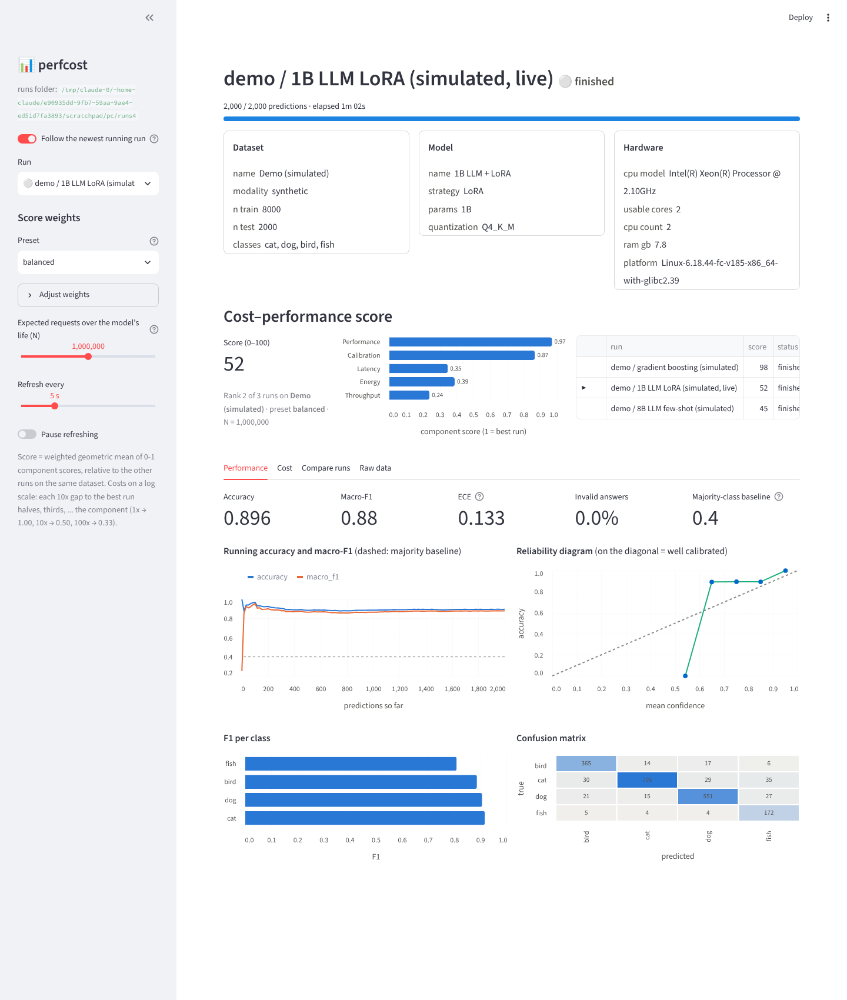

# perfcost-dash

A live dashboard that rates a classifier run on **performance and cost together**.
Start it from a notebook cell, log your predictions as they happen, and see accuracy, macro-F1,
calibration, latency, throughput, energy and a single **cost–performance score**, compared with
every other run on the same dataset.

Built for the B.Sc. thesis *Generative Models vs. Traditional Classifiers: A Comparative Study of
Cost and Performance* (GIU, 2026), but it works with any classifier: scikit-learn, XGBoost, PyTorch, or an LLM
behind an API.



## Install

```bash
pip install git+https://github.com/<you>/perfcost-dash          # from GitHub
pip install -e .                                                # from a local clone
pip install -e ".[energy]"                                      # + built-in energy tracking (CodeCarbon)
```

Requires Python ≥ 3.9 and Streamlit ≥ 1.37.

## Use it in a notebook

```python
import time
import perfcost

run = perfcost.start(
    name="adult / llama3.1-8b few-shot",
    dataset={"name": "Adult Income", "modality": "tabular", "n_train": 32561, "n_test": 16281},
    model={"name": "Llama 3.1 8B", "params": "8B", "quantization": "Q4_K_M", "strategy": "few-shot"},
    labels=["no", "yes"],
    cpus="32-63",            # optional: keep the dashboard off the cores you are measuring
)
# -> starts the dashboard in the background and prints a clickable link

for x, y in test_set:
    t0 = time.perf_counter()
    pred, conf = my_model(x)                      # pred=None for an invalid answer
    run.log(y_true=y, y_pred=pred, confidence=conf, latency_ms=(time.perf_counter() - t0) * 1000)

run.log_cost(kind="inference", mode="online", energy_kwh=0.031, n=1000)   # your own measurement
run.log_cost(kind="training", energy_kwh=0.8, wall_time_s=3600)          # if the model was trained
run.finish()
```

Also available:

| Call | What it does |
|---|---|
| `run.log_batch(y_true, y_pred, confidence, latency_ms)` | log many predictions at once |
| `run.log_cost(kind="cold_start", wall_time_s=6.2)` | any cost record; extra keywords are kept (`throughput_per_s=…`, `co2_kg=…`) |
| `with perfcost.start(...) as run:` | finishes the run automatically (marked *failed* on an exception) |
| `perfcost.start(..., track_energy=True)` | measures energy itself with CodeCarbon (live power chart) |
| `perfcost.import_run(name, y_true, y_pred, confidence, latency_ms, costs=[...])` | add an already finished run (e.g. from a CSV) so it can be compared |
| `perfcost.browse()` | open the dashboard for finished runs |
| `perfcost.stop_server()` | stop the dashboard |

Command line: `perfcost serve [--root DIR] [--port 8501] [--cpus 32-63]`, `perfcost stop`, `perfcost demo`.

Runs are stored in `./perfcost_runs/` (or `$PERFCOST_ROOT`, or `root=`), one folder per run:
`meta.json`, `events.jsonl` (one line per prediction) and `costs.jsonl`. The files are append-only text, so a
crashed run stays readable and the dashboard can read them while they are written.

### On a remote machine (VS Code Remote-SSH)

The dashboard listens on `localhost:8501` on the remote machine. VS Code forwards the port automatically
and the link opens in your local browser; if it does not, add port 8501 in the **PORTS** tab.

### Measuring energy at the same time

CodeCarbon in *machine* mode measures the whole computer, including the dashboard. Keep the dashboard light
(refresh every 5–10 s, the default) and pin it to cores you are not measuring with `cpus=`. If you already measure
energy yourself, leave `track_energy=False` and pass your numbers with `run.log_cost()`.

## What the dashboard shows

* **Header**: the run's dataset, model and hardware, with progress and time left.
* **Score**: the cost–performance score, its five components, and the run's rank among runs on the same dataset.
* **Performance**: accuracy, macro-F1, ECE, invalid answers, majority-class baseline; running accuracy/F1
  curves; reliability diagram; F1 per class; confusion matrix (or the most frequent confusions for many classes).
* **Cost**: latency (mean, p95, over time, distribution), throughput, energy per 1,000 predictions, training
  energy, cold start; live energy and power if `track_energy=True`.
* **Compare runs**: cost vs macro-F1 for every run on the dataset, and the ranking under every weight preset.

## The cost–performance score

Each run gets five component scores between 0 and 1, **relative to the other runs on the same dataset**:

| Component | Score |
|---|---|
| Performance | macro-F1 ÷ best macro-F1 |
| Calibration | 1 − ECE |
| Latency | 1 / (1 + log₁₀(latency ÷ lowest latency)) |
| Energy | 1 / (1 + log₁₀(E ÷ lowest E)), where E = inference energy per request + training energy ÷ N |
| Throughput | 1 / (1 + log₁₀(highest throughput ÷ throughput)) |

**Costs are compared on a log scale**, because they differ by orders of magnitude between model families: every
tenfold gap to the best run has the same effect (1× → 1.00, 10× → 0.50, 100× → 0.33, 1000× → 0.25). No run scores
zero just for being the most expensive.

**N** is the expected number of requests over the model's life, set with a slider. Training energy is spread over
N requests, so training-free models (prompting) look cheaper at small N and trained models at large N. This is
the same trade-off as a break-even analysis.

The total is a **weighted geometric mean**:

score = Π cᵢ^(wᵢ / Σw)

Unlike a weighted sum, a very poor component cannot be hidden by good ones. Components that are not available yet
(e.g. no energy logged) are left out and the remaining weights renormalised.

**Weights are a value judgement**, so the dashboard has three presets and sliders:

| Preset | Performance | Calibration | Latency | Energy | Throughput | Typical setting |
|---|---|---|---|---|---|---|
| accuracy-first | 0.60 | 0.10 | 0.10 | 0.10 | 0.10 | a wrong answer is expensive |
| balanced | 0.30 | 0.10 | 0.20 | 0.30 | 0.10 | default |
| green | 0.15 | 0.05 | 0.15 | 0.50 | 0.15 | high volume, energy and cost dominate |

The *Compare runs* tab ranks every run under all three presets. If a ranking holds under every preset, it does not
depend on the choice of weights. That is the claim worth reporting.

## Try it without a model

```bash
perfcost demo
```

This imports two simulated finished runs and logs a third one live for a minute. All demo numbers are simulated.

## Development

```bash
pip install -e ".[dev]"
pytest
```

## License

MIT
